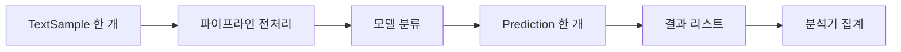

강아지 클래스의 `self`에서 시작해 문장을 전처리하고 분류하는 실습으로 이어졌다. 뒤로 갈수록 문법 하나보다 **어떤 객체에서 값을 꺼내 다음 객체에 전달하는가**가 질문의 중심이 됐다.

질문 제목은 실제 발언을 다듬었다. **의도**는 직접 밝힌 경우를 제외하면 대화 맥락에 따른 해석이다. 코드는 당시 설명을 공개용으로 재구성한 예시이며, 새로 만든 예시는 보충으로 표시했다. 설명을 들었다는 기록과 독립적으로 구현하거나 검증했다는 기록은 구분한다.

기본 개념: [[python/self-and-objects]], [[python/iterables-and-iterators]], [[python/comprehensions]]. 이번 질문의 확장: [[python/methods-types-and-inheritance]], [[python/object-state-and-composition]].

## 질문: 메서드에서 쓰지 않는 self도 적어야 할까?

**상황:** Dog의 메서드가 인스턴스 속성을 읽지 않는데도 self가 필요한지 물었다.

**의도:** 사용하지 않는 매개변수와 호출 시 자동 전달되는 인자를 구분하려 했다.

**핵심 답변:** 일반 메서드를 `dog.bark()`로 호출하면 `dog`가 첫 인자로 전달된다. 본문에서 쓰지 않더라도 받을 자리는 필요하다. `def bark():`처럼 자리가 없으면 인자 개수 오류가 난다. `self`라는 철자가 특별한 것이 아니라 호출 방식이 인스턴스를 전달한다.

## 질문: 괄호가 비어 있는데 인자 한 개가 전달됐다는 이유는?

**상황:** 인자를 쓰지 않은 호출에서 “0개를 받는데 1개가 전달됐다”는 오류가 낯설었다.

**의도:** 화면의 빈 괄호와 내부 호출 사이의 차이를 확인하려 했다.

**핵심 답변:** 이 예제의 `dog.bark()`는 `Dog.bark(dog)`처럼 풀어 볼 수 있다. 변수명 `dog`라는 글자가 넘어가는 것이 아니라 그 이름이 가리키는 인스턴스가 전달된다. `self`를 적어서 자동 전달이 생기는 순서가 아니다.

## 질문: 정적 메서드는 무엇이 다를까?

**상황:** 인스턴스를 만들지 않고 호출하는 방식과 static의 뜻을 물었다.

**의도:** 자동 인자 전달을 없애는 방법을 이해하려 했다.

**핵심 답변:** `@staticmethod`는 인스턴스나 클래스를 첫 인자로 자동 전달하지 않는다. `Dog.check(text)`와 `dog.check(text)` 모두 명시한 `text`만 받는다. “속성을 사용할 수 없다”는 제한이 아니다. 필요한 객체를 직접 인자로 받으면 그 객체의 속성과 메서드도 사용할 수 있다.

## 질문: 일반 메서드도 클래스 이름으로 호출할 수 있을까?

**상황:** 정적 메서드만 클래스에서 호출 가능하다는 설명처럼 들려 재확인했다.

**의도:** 접근 가능 여부와 인자를 자동으로 붙이는 여부를 나누려 했다.

**핵심 답변:** 일반 메서드도 `Dog.bark(dog)`처럼 호출할 수 있다. 이때는 호출에 사용할 인스턴스를 직접 전달한다. 클래스에서 일반 함수를 꺼내 호출하는 것과 인스턴스에서 바인딩된 메서드를 호출하는 것은 첫 인자를 누가 준비하는지가 다르다.

## 질문: @가 붙은 데코레이터는 언제 무엇을 할까?

**상황:** staticmethod 설명을 듣다가 데코레이터 자체의 작동이 궁금해졌다.

**의도:** 기호를 외우기보다 함수가 변환되는 순서를 알고 싶어 했다.

**핵심 답변:** 단순한 함수 데코레이터 `@decorate`는 정의 뒤 `greet = decorate(greet)`로 다시 연결하는 형태로 이해한다. 데코레이터 적용은 정의 시점에 일어난다. 데코레이터가 반환한 함수의 본문이 나중에 호출되는 시점과는 다르다. 모든 데코레이터가 단순히 출력문을 앞뒤에 붙이는 것은 아니다.

## 질문: 함수 이름만 쓰면 함수를 전달하는 것일까?

**상황:** 데코레이터 예시에서 greet와 greet()가 다른 이유를 물었다.

**의도:** 함수 객체와 실행 결과를 구분하려 했다.

**핵심 답변:** `greet`는 함수 객체를 가리키고 `greet()`는 지금 호출해서 결과를 얻는 식이다. `use(greet)`는 함수를, `use(greet())`는 결과를 넘긴다. 단독으로 이름을 적었다고 무조건 어디론가 전달되는 것은 아니다. 주변의 호출식이 그 값을 인자로 사용한다.

## 질문: del로 객체를 없애면 소멸자가 곧바로 실행될까?

**상황:** 생성과 반대로 객체가 사라지는 시점을 물었다.

**의도:** 변수 삭제와 객체 수명을 연결하려 했다.

**핵심 답변:** `del dog`는 그 이름의 연결을 지운다. 다른 이름이나 컨테이너가 같은 객체를 참조하면 객체는 남는다. `__del__`의 실행 시점에 파일 정리 같은 중요한 동작을 의존하지 않는다. 파일은 `with`로 사용 범위를 정리한다. 특정 구현에서 관찰한 즉시 정리를 모든 Python 실행환경의 보장으로 확대하면 안 된다.

## 질문: 인스턴스를 만들기 전 클래스와 상속은 설계도만 있는 상태일까?

**상황:** 상속을 정의해도 객체 생성 전에는 무엇이 존재하는지 물었다.

**의도:** 클래스 정의의 실행과 인스턴스 메서드 실행을 구분하려 했다.

**핵심 답변:** `class` 문을 실행하면 클래스 객체가 만들어진다. 아직 Dog 인스턴스는 없어도 `Dog`가 가리키는 객체는 존재한다. 부모의 메서드를 물려받았다고 그 메서드 본문이 저절로 실행되지는 않는다. 일반 메서드 본문은 해당 호출이 있어야 실행된다.

## 질문: Python 객체를 코드·데이터·스택·힙으로 나누어 이해해도 될까?

**상황:** 다른 언어에서 배운 메모리 영역을 Python 변수와 클래스에 대응시키려 했다.

**의도:** 이름, 값, 클래스가 실제로 어디에 존재하는지 명확히 하려 했다.

**핵심 답변:** 학습 코드에서는 먼저 이름 공간과 객체의 참조 관계를 추적하는 편이 정확하다. 전역 이름이면 데이터 영역, 지역 이름이면 스택이라는 식으로 곧바로 대응할 수 없다. Python의 객체 모델과 CPython 같은 구현체의 메모리 배치는 설명 층위가 다르다. 클래스 변수의 공유도 저장 영역의 이름이 아니라 속성을 어느 객체에서 찾는지로 설명한다.

## 질문: CPython은 Python과 무엇이 다를까?

**상황:** 메모리 설명에 CPython이 등장하자 언어와 실행기의 관계를 되물었다.

**의도:** 구현에 따른 성질을 언어 자체의 규칙과 구분하려 했다.

**핵심 답변:** Python은 언어이고 CPython은 그 언어를 실행하는 대표적인 구현이다. 소스의 `x = 1`만 보고 네이티브 프로그램의 특정 메모리 구역을 확정할 수는 없다. 이름이 객체를 참조한다는 코드 수준 설명과 구현체 내부 구조를 분리한다.

## 질문: 대입할 때마다 새 객체가 만들어질까?

**상황:** 할당은 새 값 객체를 만드는지 기존 객체를 가리키는지 물었다.

**의도:** 같은 값과 같은 객체를 구분하려 했다.

**핵심 답변:** 오른쪽 식에 따라 다르다. `a = []`는 새 리스트를 만들고 `b = a`는 같은 리스트를 가리키게 한다. `a == b`는 값 비교이고 `a is b`는 동일 객체인지 확인한다. 작은 정수 재사용 같은 최적화를 일반적인 대입 규칙으로 삼지 않는다.

## 질문: 오른쪽에 적힌 것은 모두 객체일까?

**상황:** 대입 설명을 들은 뒤 오른쪽 코드 전체를 객체라고 불러도 되는지 확인했다.

**의도:** 표현식과 그 평가 결과를 나누려 했다.

**핵심 답변:** 오른쪽에 적힌 소스 글자 자체와 평가해 얻은 객체는 다르다. `x = 1 + 2`에서는 식을 평가해 정수 객체를 얻고 x가 이를 참조한다. `None`도 객체다. 평가 도중 예외가 나면 결과 객체를 얻고 대입하는 단계까지 가지 못한다.

## 질문: classmethod의 cls는 어떻게 클래스가 될까?

**상황:** 클래스 자체도 객체라는 설명 뒤 클래스 메서드의 첫 인자를 물었다.

**의도:** self와 cls가 단순 이름인지 호출 규칙인지 확인하려 했다.

**핵심 답변:** `@classmethod`로 정의한 메서드를 호출하면 클래스가 첫 인자로 바인딩된다. `cls`는 관례적인 이름이다. 이름을 self로 바꿔도 받는 대상은 클래스다. 다만 실제 인스턴스를 뜻하는 self와 혼동되므로 cls를 쓴다.

## 질문: 점으로 접근하는 것과 메서드를 실행하는 것은 같을까?

**상황:** dog.introduce 같은 표현이 무엇을 가져오는지 물었다.

**의도:** 속성 조회와 함수 호출의 경계를 찾으려 했다.

**핵심 답변:** 이 일반 메서드 예시에서 `dog.introduce`는 호출할 인스턴스와 함수를 연결한 바인딩된 메서드를 얻고, `dog.introduce()`가 그것을 호출한다. `dog.name`은 속성 조회다. `dog.name = "초코"`처럼 대입 왼쪽에 있으면 속성을 설정하는 동작이다.

## 질문: 부모 클래스의 area에 pass만 있으면 자식이 꼭 구현해야 할까?

**상황:** Shape.area의 빈 본문이 어떤 역할인지 물었다.

**의도:** 상속용 틀과 강제 규칙의 차이를 확인하려 했다.

**핵심 답변:** `pass`는 아무 동작도 하지 않는 문장이다. 그대로 호출하면 함수 끝에 도달해 `None`을 반환한다. 자식이 같은 이름의 메서드를 정의하면 재정의되지만, pass 자체가 재정의를 강제하지는 않는다. 강제하고 싶을 때 쓰는 추상 메서드는 별도 장치다.

## 질문: 클래스 안의 count를 count += 1로 늘리면 왜 오류가 날까?

**상황:** Counter를 만들면서 누적 횟수 변경에 오류가 났다.

**의도:** 지역 변수, 인스턴스 속성, 클래스 속성 중 어느 것을 바꾸는지 찾으려 했다.

**핵심 답변:** 함수 안에서 `count += 1`은 count에 대입하므로 지역 이름으로 취급된다. 먼저 읽을 지역 값이 없으면 `UnboundLocalError`가 난다. 공용 횟수를 바꾸려는 예제라면 `Counter.count += 1`이다. `self.count += 1`은 기본적인 속성 동작에서는 클래스 값을 읽은 뒤 인스턴스 속성에 저장해 공용 값과 갈라질 수 있다.

## 질문: a.count = 10은 클래스 변수도 바꿀까?

**상황:** 얕은 복사를 묻다가 클래스 속성 가리기까지 다시 확인했다.

**의도:** 조회와 대입이 같은 대상을 다루는지 확인하려 했다.

**핵심 답변:** 인스턴스 a에 별도 count가 없다면 `a.count` 조회가 클래스 값으로 이어질 수 있다. 하지만 일반적인 `a.count = 10`은 a의 속성을 만들거나 바꾼다. 다른 인스턴스는 여전히 클래스의 값을 읽을 수 있다. 이것은 숫자를 공유 메모리 구역에 넣는 문제가 아니라 속성 조회와 저장 위치의 문제다.

## 질문: 얕은 복사는 겉 리스트만 새로 만드는 것일까?

**상황:** 중첩 리스트의 복사를 보고 바깥과 안쪽이 같은 객체인지 물었다.

**의도:** 복사 뒤 어느 수정이 원본에 보이는지 예상하려 했다.

**핵심 답변:** `b = a.copy()`는 새 바깥 리스트를 만들지만 안쪽 객체의 참조를 그대로 담는다. `a = [[1, 2], [3, 4]]`라면 `a is b`는 False, `a[0] is b[0]`는 True다. `b.append([5])`는 바깥 b만 바꾸고 `b[0].append(9)`는 공유한 안쪽 리스트를 바꾼다.

## 질문: 복사는 리스트에만 있는 개념일까?

**상황:** 얕은 복사를 다른 객체에도 적용할 수 있는지 물었다.

**의도:** 자료형별 메서드와 공통 복사 개념을 구분하려 했다.

**핵심 답변:** 딕셔너리에도 얕은 복사가 있고 일반 인스턴스에도 `copy.copy()`를 적용할 수 있다. 모든 객체에 `.copy()` 메서드가 있는 것은 아니다. 복사 가능 여부와 동작은 객체 종류에 따라 다르다.

## 질문: 깊은 복사는 정확히 무엇을 복사할까?

**상황:** deepcopy의 정의를 다시 요청했다.

**의도:** 중첩된 참조를 어느 단계까지 따라가는지 확인하려 했다.

**핵심 답변:** `copy.deepcopy()`는 내부에서 참조하는 객체를 재귀적으로 복사한다. 중첩된 가변 객체의 변경이 원본과 분리되게 하는 데 유용하다. 불변 객체는 그대로 재사용될 수 있고 공유 관계나 순환 참조도 처리하므로 “모든 메모리를 무조건 새로 만든다”는 뜻은 아니다.

## 질문: 객체지향을 더 공부하려면 어떤 질문으로 이어가면 좋을까?

**상황:** 기본 호출 뒤에도 더 깊은 개념을 요청했다.

**의도:** 새 용어를 외우기보다 지금 코드의 혼란을 풀 다음 주제를 찾으려 했다.

**핵심 답변:** 당시 대화에서는 바인딩·동일성·가변성·속성 탐색을 먼저 연결하고, 객체가 지킬 조건과 역할 분리, 상속과 합성, 다형성으로 넓히는 방향이 제시됐다. 이는 후속 학습 제안이며 해당 내용을 모두 구현하거나 익혔다는 기록은 아니다. 이번 정리는 바로 이어진 사례인 [[python/object-state-and-composition|객체 상태와 합성]]까지 다룬다.

## 질문: sample_id: int와 -> str은 값을 넣는 문법일까?

**상황:** TextSample에서 타입 표기가 처음 등장했다.

**의도:** 매개변수 이름, 기본값, 반환값과 타입 힌트를 구분하려 했다.

**핵심 답변:** `sample_id: int`는 sample_id가 정수일 것으로 기대한다는 타입 표기이고 `-> str`은 반환 타입 표기다. 값을 대입하거나 실제 값을 반환하는 문장이 아니다. `return`은 따로 필요하고, Python 실행 자체가 모든 타입 힌트를 검사해 주지도 않는다.

## 질문: 정수여야 한다가 아니라 정수일 것으로 기대한다는 이유는?

**상황:** 타입 설명의 표현이 느슨하게 들려 다시 물었다.

**의도:** 힌트와 실행 시 검증의 효력을 비교하려 했다.

**핵심 답변:** 타입 힌트만 있는 함수는 다른 타입의 인자를 받아도 호출 자체가 바로 차단되지는 않는다. 본문에서 `+`나 `.strip()`을 실행하다 실제 타입에 맞지 않아 오류가 날 수 있다. 실행 시 거절하려면 별도 검사와 예외 처리를 작성한다.

## 질문: __str__와 __len__은 타입 힌트와 같은 약속일까?

**상황:** 두 특수 메서드의 이름과 반환 형식이 낯설었다.

**의도:** 내장 함수가 객체의 어떤 메서드를 사용하는지 이해하려 했다.

**핵심 답변:** `str(sample)`이나 `print(sample)`에서 쓰는 `__str__`는 문자열을 반환해야 한다. `len(sample)`에 쓰는 `__len__`는 유효한 비음수 정수를 반환해야 한다. 이는 `-> str`, `-> int`라는 주석만의 기대와 다르며 내장 동작이 실제로 요구하는 계약이다.

## 질문: 문자열과 정수는 어떻게 검증하면 될까?

**상황:** TextSample.validate를 구현하기 위한 조건을 물었다.

**의도:** 조건 검사 순서와 타입 검사 기준을 정하려 했다.

**핵심 답변:** `isinstance(text, str) and bool(text.strip())`는 문자열인지 먼저 확인한 뒤 공백만 있는지 검사한다. and가 단락 평가하므로 문자열이 아닐 때 strip을 호출하지 않는다. `isinstance(True, int)`는 True이므로 bool을 제외한 정확한 int만 허용하려는 조건이라면 `type(sample_id) is int`처럼 요구에 맞게 정한다.

## 질문: 정적 메서드 안에서도 다른 인스턴스 메서드를 호출할 수 있을까?

**상황:** 정적 메서드는 속성이나 메서드를 사용할 수 없다고 생각했다.

**의도:** 접근 제한과 자동 전달의 차이를 실제 호출에 적용하려 했다.

**핵심 답변:** 가능하다. `@staticmethod`인 `relay(speaker)` 안에서 `speaker.say()`를 호출할 수 있다. 다만 speaker를 자동으로 받지 않으므로 호출자가 전달해야 한다. 이 차이를 [[python/methods-types-and-inheritance]]의 예제로 확인할 수 있다.

## 질문: 텍스트만 받는 is_valid_text에서 sample 전체를 검증할 수 있을까?

**상황:** 텍스트용 정적 메서드와 인스턴스 validate의 연결이 헷갈렸다.

**의도:** 현재 인자로 가진 정보의 범위를 따지려 했다.

**핵심 답변:** text만 받은 함수는 그 문자열을 검사할 수 있지만 자동으로 어떤 TextSample의 sample_id와 label을 알지는 못한다. 인스턴스의 validate에서 `self.text`를 검사 함수로 넘기는 방향이 자연스럽다. 인스턴스를 사용하려면 무조건 그 자리에서 생성자를 다시 호출해야 하는 것은 아니다. 이미 받은 객체를 사용할 수 있다.

## 질문: 공백 문자열과 문장부호는 어떤 기준으로 처리할까?

**상황:** 공백만 있는 텍스트와 RemovePunctuation의 제거 범위를 물었다.

**의도:** 작동하는 조건과 문제에 명시된 범위를 구분하려 했다.

**핵심 답변:** `"   ".strip()`은 빈 문자열이므로 유효한 내용이 없다고 판단할 수 있다. `string.punctuation`을 쓰면 ASCII 문장부호를 검사한다. 모든 언어의 모든 문장부호가 포함되는 것은 아니다. 당시 문제 예시만으로 유니코드 전체 제거를 요구한다고 단정할 수 없었다.

## 질문: 문장부호를 빼고 문자열을 다시 만들려면?

**상황:** RemovePunctuation 클래스의 전체 작성 예를 요청했다.

**의도:** 조건으로 문자를 거른 뒤 결과를 결합하는 과정을 연결하려 했다.

**핵심 답변:** 문자열을 순회하며 제거 대상이 아닌 문자만 모아 join으로 이어 붙인다. 원본 문자열의 문자를 제자리에서 지우는 방식은 아니다.

```python
import string

def remove_punctuation(text):
    return "".join(char for char in text if char not in string.punctuation)

assert remove_punctuation("hello!!!") == "hello"
```

## 질문: return을 썼는데 파이프라인 결과가 None인 이유는?

**상황:** 저장된 코드만 읽은 답변이 pass를 원인으로 지목했지만, 사용자는 화면에 return이 있다고 바로잡았다. 이후 run 코드를 직접 제시했다.

**의도:** 실제 실행 경로에서 값이 끊기는 위치를 찾으려 했다.

**핵심 답변:** 당시 최종 제시된 `PreprocessingPipeline.run`은 각 처리기의 반환값을 text에 다시 넣지만 반복이 끝난 값을 반환하지 않았다. return은 개별 처리기뿐 아니라 run에도 필요하다. 이전 화면 진단은 최신 편집 내용과 맞지 않았으며 이를 분리해야 한다.

```python
def run(self, text):
    for processor in self.processors:
        text = processor.process(text)
    return text
```

return을 for 안에 넣으면 첫 처리기 뒤 종료된다.

## 질문: 분류기는 어떤 단어를 어느 결과로 바꾸는 문제일까?

**상황:** KeywordClassifier의 문제 규칙 자체를 다시 요청했다.

**의도:** 구현 전 입력과 출력 조건을 확인하려 했다.

**핵심 답변:** 당시 규칙은 python 또는 class이면 python, rag 또는 retrieval이면 rag, ai·machine·model·language 중 하나이면 ai, 어느 것도 없으면 unknown이었다. 여러 범주의 단어가 함께 있는 문장의 우선순위는 예시만으로 확정하지 않는다. if/elif 순서를 정하면 먼저 참인 조건이 결과를 결정한다.

## 질문: if "python" or "class" in text가 왜 항상 첫 분류로 갈까?

**상황:** 분류기 테스트 네 개가 모두 python으로 나왔다.

**의도:** 필터 결과가 입력과 무관해진 조건을 찾으려 했다.

**핵심 답변:** 이 식은 `("python") or ("class" in text)`로 평가된다. 빈 문자열이 아닌 python 자체가 참으로 취급되어 입력을 검사하지 않아도 조건을 통과한다. `"python" in text or "class" in text`처럼 양쪽 모두 포함 검사를 쓴다.

## 질문: python은 문자열인데 어떻게 True가 될까?

**상황:** rag 문장에 python이 없는데도 참이라는 설명이 납득되지 않았다.

**의도:** 문자열의 타입과 조건 문맥의 참·거짓을 구분하려 했다.

**핵심 답변:** python은 여전히 문자열이다. if는 객체를 조건으로 해석할 때 참·거짓을 판단하고 비어 있지 않은 문자열은 참이다. 문자열 내용이 입력 문장 안에 있는지를 검사하는 기능은 없다. 그 검사는 `in`을 써야 한다.

## 질문: 단어 in 문장과 단어1, 단어2 in 문장은 같은 검사일까?

**상황:** 따옴표, in의 방향, 쉼표로 두 단어를 묶는 방법을 이어서 물었다.

**의도:** 포함 조건을 정확한 문법으로 표현하려 했다.

**핵심 답변:** `"python" in text`가 “문장에 단어가 포함됐는가”다. 쉼표는 두 포함 조건을 묶는 or가 아니다. 둘 중 하나면 `"python" in text or "class" in text`, 둘 다면 and를 쓴다. `text in "python"`은 검사 방향이 반대다.

## 질문: type(model).__name__과 print의 쉼표는 무엇일까?

**상황:** 클래스 이름을 출력하면서 f-string 없이 쉼표를 쓴 이유를 물었다.

**의도:** 클래스 객체, 이름 문자열, 출력 형식을 구분하려 했다.

**핵심 답변:** `type(model)`은 클래스이고 그 `__name__`은 이름 문자열이다. `print(name, "->", result)`는 세 인자를 기본 공백으로 구분해 출력한다. `print(f"{name} -> {result}")`는 문자열 하나를 먼저 만들어 전달한다. 문자열 출력에 f가 항상 필요한 것은 아니다.

## 질문: Prediction은 분류하는 클래스일까, 결과를 담는 클래스일까?

**상황:** 11번 문제를 반복해서 설명해 달라고 한 뒤 작성 예를 요청했다.

**의도:** 이미 만든 모델과 새 객체의 역할을 나누려 했다.

**핵심 답변:** Prediction은 이미 계산된 `sample_id`, `input_text`, `processed_text`, `prediction` 네 값을 저장한다. 분류 계산은 모델이 한다. `__str__`가 `[1] python`만 보여 주더라도 원본과 전처리 문자열은 객체에 그대로 보관될 수 있다. 출력 형식이 저장된 속성 전체를 뜻하지 않는다.

## 질문: 속성 초기화가 __str__에 있으면 왜 안 될까?

**상황:** 화면에서 값 저장 코드가 __init__이 아니라 __str__ 안에 있어 이유를 물었다.

**의도:** 객체를 만들 때와 출력할 때 실행되는 일을 나누려 했다.

**핵심 답변:** 네 속성은 __init__에서 저장하는 것이 해당 실습의 구조다. __str__는 이미 저장된 `self.sample_id`와 `self.prediction`으로 문자열을 만든다. __init__의 지역 매개변수 sample_id가 별도 메서드에도 자동으로 이어지는 것은 아니다. 들여쓰기로 어느 메서드 본문인지 확인해야 한다.

## 질문: AIEngine.run에서 앞서 만든 클래스들을 어떻게 연결할까?

**상황:** 클래스를 하나씩 만들었지만 이름과 역할이 한꺼번에 혼동됐다.

**의도:** 한 문장이 이동하는 순서로 전체 흐름을 잡으려 했다.

**핵심 답변:** TextSample에서 원문을 꺼내 pipeline.run에 넣고, 나온 문자열을 model.predict에 넣고, 결과를 Prediction에 묶는다. 엔진은 이 순서를 연결한다.

```python
def run(self, sample):
    processed_text = self.pipeline.run(sample.text)
    prediction = self.model.predict(processed_text)
    return Prediction(sample.sample_id, sample.text, processed_text, prediction)
```

여기서 소문자 prediction은 분류 문자열, 대문자 Prediction은 결과 객체를 만드는 클래스다.

## 질문: [100] None에서 None은 샘플 번호가 잘못된 것일까?

**상황:** 12-1 결과를 보고 sample_id가 None인지 물었다.

**의도:** 출력 위치와 실제 속성을 대응시키려 했다.

**핵심 답변:** 당시 `[100]`은 번호였고 뒤의 None이 분류 결과였다. 코드에서는 `predicition`에 계산값을 저장하고 `prediction`을 결과 생성자에 전달했다. 두 이름은 별개다. 출력 문자열의 각 부분이 어느 속성에서 왔는지 추적해야 원인 위치를 잡을 수 있다.

## 질문: 오타가 있는데 왜 NameError가 아니라 None이 나왔을까?

**상황:** 두 철자가 다른데 예외 없이 반환된 점을 다시 물었다.

**의도:** 노트북에 남은 이름이 함수에 끼치는 영향을 확인하려 했다.

**핵심 답변:** 함수 안에 prediction 대입이 없고 바깥 이름 공간에 prediction이 있으면 그 값을 읽을 수 있다. 당시 답변은 이전 셀의 prediction을 원인으로 설명했다. 원문에 런타임 전체 덤프가 남은 것은 아니므로 남은 전역 값은 설명 가능한 원인으로 구분한다. 아래는 재현용 보충 예다.

```python
prediction = None
def typo_example():
    predicition = "python"
    return prediction

assert typo_example() is None
```

바깥 이름도 없으면 NameError가 난다.

## 질문: raw_samples는 딕셔너리일까, 딕셔너리들의 리스트일까?

**상황:** id와 text가 한 중괄호 안에 같이 있는 구조가 낯설었다.

**의도:** 컨테이너의 바깥과 안쪽 타입을 각각 읽으려 했다.

**핵심 답변:** 전체는 리스트이고 항목 하나가 딕셔너리다. 당시 항목에는 id·text·label 세 쌍이 있었다. `raw_samples[0]`으로 한 딕셔너리를 꺼낸 뒤 `raw_samples[0]["text"]`로 그 안의 문자열을 꺼낸다. 딕셔너리는 키·값 쌍을 여러 개 가질 수 있다.

## 질문: 컴프리헨션에서 for 앞에 TextSample을 쓰는 이유는?

**상황:** 13번 변환 코드에서 결과를 만드는 식이 앞에 있어 순서가 헷갈렸다.

**의도:** 각 반복에서 객체가 한 번씩 만들어지는지 확인하려 했다.

**핵심 답변:** `[TextSample(item["id"], item["text"], item["label"]) for item in raw_samples]`는 항목을 item에 넣은 뒤 앞의 식을 평가해 결과 리스트에 추가한다. 객체 하나를 미리 만든 뒤 반복하는 것이 아니다. 일반 for문의 append 안 표현식을 앞에 쓴 것으로 풀어 보면 된다.

## 질문: 뒤에서 꺼낸 변수를 앞의 식에서 어떻게 사용할까?

**상황:** num이 for 뒤에 나오는데 앞의 num * 10에서 이미 사용되는 점을 되물었다.

**의도:** 작성 순서와 실행 순서가 다른 문법을 이해하려 했다.

**핵심 답변:** `[num * 10 for num in numbers]`는 글의 왼쪽부터 모든 부분을 실행하는 문장이 아니다. 반복에서 num을 먼저 바인딩하고 결과 식을 계산한다. 실행을 추적할 때는 for절을 먼저 읽고 앞의 식으로 돌아온다.

## 질문: for 앞의 식에서 반복 변수를 사용하지 않아도 될까?

**상황:** 결과 식과 반복 변수의 관계를 일반화했다.

**의도:** 항목의 값이 아니라 반복 횟수만 쓰는 경우를 확인하려 했다.

**핵심 답변:** 가능하다. `["안녕" for _ in [1, 2, 3]]`은 안녕 세 개가 든 리스트다. 반복 변수는 결과 식 외에 뒤의 필터 조건에서만 쓰일 수도 있다. 나중의 `1 for sample in samples if ...`가 바로 조건을 통과할 때마다 같은 1을 내는 사례다.

## 질문: count_by_prediction은 어떤 것을 하나씩 세는 함수일까?

**상황:** 15번 집계 함수를 구현할 지식부터 요청했다.

**의도:** 객체를 세는 일과 그 객체의 특정 속성별로 세는 일을 연결하려 했다.

**핵심 답변:** self.predictions에서 Prediction 객체를 하나씩 꺼내 result.prediction 문자열을 읽는다. 처음 나온 문자열이면 1을 저장하고, 이미 키가 있으면 1을 더한다. 빈 딕셔너리에서 바로 `counts[category] += 1`을 하면 없는 키를 읽어 오류가 난다. 모든 반복 뒤 완성된 counts를 반환한다.

## 질문: predictions에는 엔진 객체가 들어 있을까, 결과 객체가 들어 있을까?

**상황:** 분석기에 전달된 매개변수 안의 실제 값을 물었다.

**의도:** 생성자, 실행 도구, 실행 결과를 분리하려 했다.

**핵심 답변:** `[engine.run(sample) for sample in samples]`는 각 run이 반환한 Prediction 객체를 모은 리스트다. 엔진을 다섯 개 담은 것이 아니다. 첫 항목은 번호 1, 원문, 전처리문, 분류 python을 각각 속성으로 가진다. 분석기는 리스트를 받아 저장한 뒤 필요한 분류 속성만 읽는다.

## 질문: 객체 관계와 실행 순서를 그림으로 나눌 수 있을까?

**상황:** 머릿속으로만 관계를 추적하기 어려워 실제 값이 보이는 그림을 요청했다.

**의도:** 무엇을 보관하는지와 누구를 호출하는지를 따로 보고 싶어 했다.

**핵심 답변:** 객체가 가진 참조와 호출 순서는 서로 다른 정보다. 엔진은 파이프라인과 모델을 보관하고, 실행 중에는 전처리 → 예측 → 결과 객체 생성 순서로 호출한다. 당시 별도 HTML은 생성됐지만 요청한 Chrome 자동 열기는 완료되지 않았다고 보고됐다. 아래는 공개 글을 위한 보충 도식이다.



## 질문: correct_count는 분류별 개수와 무엇이 다를까?

**상황:** 집계 함수 다음에 정답 개수 함수의 역할을 물었다.

**의도:** 정답 라벨과 예측 라벨 중 무엇을 비교하는지 확인하려 했다.

**핵심 답변:** 분류별 집계는 python이 몇 번 예측됐는지를 센다. correct_count는 같은 샘플의 `sample.label == result.prediction`을 비교해 맞힌 개수를 센다. zip으로 묶는다면 두 리스트가 같은 샘플 순서이며 길이가 일치하는지 전제가 필요하다. 이는 정답과 예측을 짝짓는 문제다.

## 질문: 맞힌 개수를 세었는데 accuracy에서 오류가 나는 이유는?

**상황:** 15번 오류를 다시 확인했다.

**의도:** 앞 메서드의 반환값이 다음 계산에 무엇으로 들어가는지 추적하려 했다.

**핵심 답변:** 당시 correct_count에는 마지막 `return count`가 빠져 있었다. 계산을 해도 반환하지 않으면 호출자는 None을 받고 이후 float 변환 등이 실패한다. return은 반복 밖에서 전체 개수를 돌려준다. 파이프라인의 None 문제와 같은 반환 연결 문제다.

## 질문: 정확도가 1.0이면 이상한 결과일까?

**상황:** 실습 정확도가 1.0이 나와 가능한 수치인지 물었다.

**의도:** 비율과 퍼센트, 작은 예제의 성공 범위를 구분하려 했다.

**핵심 답변:** 당시 확인한 다섯 예제는 정답과 예측이 모두 일치했다. `5 / 5 = 1.0`은 100%다. 이것은 그 다섯 문장에 대한 결과이며 새 문장 모두에 대한 성능 보장은 아니다. 실습 출력 확인을 일반적인 모델 성능이나 학습자의 숙련도 증거로 확대하지 않는다.

## 질문: {sample.label for sample in samples}는 값 없는 딕셔너리일까?

**상황:** 중괄호를 보고 딕셔너리의 키만 채우는 것인지 물었다.

**의도:** 집합과 딕셔너리 컴프리헨션을 구분하려 했다.

**핵심 답변:** 이 표현은 set을 만든다. sample 객체에서 꺼낸 label 문자열을 모으므로 중복 라벨은 하나만 남는다. 딕셔너리는 `{sample.sample_id: sample.label for sample in samples}`처럼 키:값을 적는다. 빈 `{}`는 딕셔너리이고 빈 집합은 `set()`이다.

## 질문: 집합은 딕셔너리의 키와 같은 것일까?

**상황:** set을 값 없는 딕셔너리처럼 이해해도 되는지 되물었다.

**의도:** 공통 성질과 실제 자료형을 구분하려 했다.

**핵심 답변:** 둘 다 중복 없는 해시 가능한 항목을 다룬다는 점은 연결된다. 하지만 set 자체와 딕셔너리는 다른 타입이고, 딕셔너리의 개별 키가 set인 것도 아니다. 딕셔너리는 각 키에 값을 연결하고, set은 항목의 존재와 집합 연산을 다룬다.

## 질문: label_counts의 sum 안에서 왜 1을 반복할까?

**상황:** 이중으로 보이는 컴프리헨션에서 숫자가 밸류가 되는 과정이 끊겼다.

**의도:** 필터, 개수 세기, 딕셔너리 생성을 순서로 펼치려 했다.

**핵심 답변:** 바깥 반복은 개수를 세려는 label 하나를 고른다. 안쪽은 해당 label과 같은 sample만 통과시키고 매번 1을 내보낸다. 그 합이 개수가 되어 해당 키의 값이 된다.

```python
label_counts = {
    label: sum(1 for sample in samples if sample.label == label)
    for label in labels
}
```

python이 두 번 등장한다면 sum이 더하는 값은 1, 1이고 결과는 2다.

## 질문: 컴프리헨션 뒤의 if는 어떤 값을 넣을지 고르는 것일까?

**상황:** 조건이 붙은 컴프리헨션을 처음 봤다고 했다.

**의도:** 조건이 거짓인 항목이 결과에 어떻게 남는지 확인하려 했다.

**핵심 답변:** 뒤의 if는 필터다. `[n * 10 for n in [1, 2, 3, 4] if n % 2 == 0]`은 `[20, 40]`이다. 거짓인 항목 자리에 0이나 None을 넣지 않는다. 항목 가져오기 → 조건 검사 → 통과하면 결과 식 계산 순서다.

## 질문: sum 안에 대괄호가 없는데도 리스트가 생길까?

**상황:** 설명 중 [1, 1]이라는 값 예시를 보고 실제 중간 리스트가 만들어지는지 물었다.

**의도:** 값의 흐름을 그린 예시와 실제 생성 타입을 구분하려 했다.

**핵심 답변:** `sum([1 for ...])`는 리스트를 먼저 만들지만 `sum(1 for ...)`는 제너레이터 표현식을 소비한다. 함수에 유일한 인자로 전달할 때 제너레이터 표현식 괄호 한 겹을 생략할 수 있다. 설명용 [1, 1] 표기는 실제 리스트 할당의 증거가 아니다.

## 질문: 제너레이터는 언제 계산하고 어디까지 진행했는지 기억할까?

**상황:** 처음 접한 generator를 자세히 설명해 달라고 했다.

**의도:** 리스트를 한꺼번에 만드는 방식과 비교하려 했다.

**핵심 답변:** 제너레이터는 next 요청 때 실행을 진행해 다음 값을 내고 멈춘다. `(n * 10 for n in [1, 2, 3])`에 next를 세 번 호출하면 10, 20, 30이고 이후는 StopIteration이다. 한 번 소진한 제너레이터를 sum에 다시 주면 남은 값이 없어 0이다.

## 질문: 직접 next를 쓰지 않았는데 누가 다음 값을 요청할까?

**상황:** 제너레이터가 이전의 이터레이터와 닮았다는 점을 짚었다.

**의도:** 숨겨진 반복 소비 주체를 찾으려 했다.

**핵심 답변:** 제너레이터는 이터레이터의 한 종류다. `sum(values)`와 for가 반복 프로토콜을 통해 다음 값을 요청한다. 직접 while/next/except로 펼친 코드는 동작을 이해하기 위한 모형이지 내장 sum의 실제 구현 소스를 옮긴 것은 아니다.

## 질문: StopIteration을 except로 받는 이유와 yield의 역할은?

**상황:** 예외 처리 부분과 제너레이터를 만드는 다른 방법을 함께 물었다.

**의도:** 값을 내는 것, 끝을 알리는 것, 예외 처리 문법을 나누려 했다.

**핵심 답변:** StopIteration은 더 이상 값이 없다는 종료 신호다. for는 이를 받아 반복을 끝낸다. 함수 안에 yield를 쓰면 호출 시 제너레이터 객체를 만들고, next 때 yield까지 진행한 뒤 멈춘다. return은 그 실행을 끝내고 yield는 값을 내며 일시 정지한다. 자세한 기본 비교는 [[python/iterables-and-iterators]]로 연결한다.

## 질문: 제너레이터 표현식을 대입하면 아무 일도 안 하는 것일까?

**상황:** values에 표현식을 넣는 줄은 객체 정의뿐이라고 이해해도 되는지 확인했다.

**의도:** 생성 시점의 실행과 지연되는 실행의 경계를 확인하려 했다.

**핵심 답변:** 객체 생성도 실행이다. 가장 바깥 반복 대상의 식을 평가하고 그 이터레이터를 얻는 준비는 생성 시점에 한다. 각 항목의 `n * 10` 같은 본문 계산은 다음 값을 요청할 때 진행한다. “모든 코드가 무조건 나중에 실행된다”는 표현은 너무 넓다.

## 질문: 제너레이터가 아닌 이터레이터는 어떻게 만들까?

**상황:** generator가 iterator의 한 종류임을 확인한 뒤 나머지 종류를 물었다.

**의도:** 공통 인터페이스와 생성 방법을 분리하려 했다.

**핵심 답변:** `iter([10, 20, 30])`은 리스트 이터레이터다. next를 호출해도 원본 리스트를 삭제하는 것이 아니라 읽는 위치가 이동한다. 직접 만들 때는 `__iter__`에서 자신을 반환하고 `__next__`에서 다음 값 또는 StopIteration을 제공한다. 제너레이터의 실행 상태는 Python이 관리하고 직접 만든 이터레이터는 보통 속성으로 진행 상태를 관리한다.

## 이 기록의 범위

문장 다섯 개의 분류 결과를 확인한 범위와 일반 개념 설명을 구분했다. TextSample 세션 말미의 추가 분류기 오류 문의는 당시 화면 연결 실패로 코드를 확인하지 못했다. 필터 세션 맨 끝의 추가 오류 문의도 원인과 후속 결과가 남아 있지 않다. 이 문의들까지 해결됐다고 기록하지 않는다.

## 이 기록의 범위

반환 누락과 조건식·철자 오류의 설명, 다섯 예제의 정확도 확인이 기록되어 있다. 전체 과제 제출이나 모든 개념의 숙련도를 확인한 기록은 아니다. 일부 초기 화면 진단은 사용자 제시 코드로 정정했으며, 미확인 화면의 오류를 완결된 해결 사례로 만들지 않았다.
