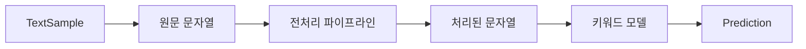

`self.book_list`라는 글자만으로는 어느 목록인지 알 수 없다. **지금 `self`가 누구이고, 그 속성이 어떤 객체를 가리키는지** 따라가야 한다. 같은 목록 객체를 두 이름이 함께 가리킬 수도 있고, 서로 다른 목록이 같은 책 객체를 담을 수도 있다.

기본 호출 관계는 [[python/self-and-objects]], 호출 종류와 타입 규칙은 [[python/methods-types-and-inheritance]]에 정리했다. 여기서는 [[learning/2026-09-21-oop-text-pipeline|9월 21일 복사·분류기 질문]]과 [[learning/2026-09-22-library-and-csv|9월 22일 도서 대여 질문]]에서 반복된 상태 구분을 다룬다.

## 변수에는 객체를 가리키는 이름이 붙는다

`a = [1, 2]`에서 `a`는 리스트 객체를 가리키는 이름이다. `b = a`는 리스트를 복사하는 문장이 아니다. `a`와 `b`가 같은 객체를 가리킨다. 이후 `a`를 다른 리스트에 연결하는 것과 기존 리스트를 변경하는 것도 다르다.

```python
a = [1, 2]
b = a
a.append(3)
print(b)       # [1, 2, 3]

a = [9]
print(a)       # [9]
print(b)       # [1, 2, 3]
```

이 **보충 예제**에서 `append`는 기존 객체를 변경했다. 두 번째 대입은 이름 `a`가 가리키는 객체를 바꿨다. `b`의 연결은 바꾸지 않았다. 이 관계를 이해하기 위해 모든 이름을 “스택”, 모든 객체를 “힙”이라고 단정할 필요는 없다. 구체적인 메모리 배치는 Python 구현에 관한 별도 문제다.

`del a` 역시 이름 연결을 지우는 동작이다. 다른 참조가 남아 있거나 순환 참조가 있는지, 어떤 Python 구현인지에 따라 객체 정리 시점이 달라질 수 있다. 소멸자가 즉시 실행된다고 일반화하지 않는다.

## 얕은 복사는 바깥 컨테이너를 새로 만든다

아래는 중첩 리스트를 비교하는 **보충 예제**다.

```python
from copy import deepcopy

original = [[1], [2]]
alias = original
shallow = original.copy()
deep = deepcopy(original)

original[0].append(9)
original.append([3])

print(original)  # [[1, 9], [2], [3]]
print(alias)     # [[1, 9], [2], [3]]
print(shallow)   # [[1, 9], [2]]
print(deep)      # [[1], [2]]
```

| 이름 | 바깥 리스트 | 내부 리스트 | 관찰한 결과 |
| --- | --- | --- | --- |
| `alias` | 원본과 같음 | 원본과 같음 | 내부 변경과 바깥 추가 모두 보임 |
| `shallow` | 새 객체 | 원본과 공유 | 내부 변경만 보임 |
| `deep` | 새 객체 | 이 예제에서는 새 객체 | 두 변경 모두 보이지 않음 |

“깊은 복사는 모든 값을 언제나 새로 만든다”도 정확하지 않다. 불변 객체는 재사용될 수 있고 사용자 정의 복사 동작도 있다. 여기서 확인한 것은 **중첩 리스트의 공유 관계**다. 값의 같음을 비교하는 `==`와 같은 객체인지를 확인하는 `is`도 구별한다.

## 클래스 속성 조회와 인스턴스 속성 대입

다음은 특별한 속성 제어 기능을 정의하지 않은 일반 클래스의 **보충 예제**다.

```python
class Counter:
    count = 0

    def increment(self):
        self.count += 1

a = Counter()
b = Counter()
a.increment()

print(a.count)        # 1
print(b.count)        # 0
print(Counter.count)  # 0
```

처음 `a.count`를 읽을 때는 인스턴스에 그 속성이 없어 클래스의 `0`을 찾는다. 그다음 `self.count += 1`은 이 예제에서 `a`에 인스턴스 속성 `count = 1`을 만든다. 클래스의 `count`를 올린 결과가 아니다. `Counter.count += 1`로 클래스 쪽에 대입하는 동작과 구별해야 한다.

함수 안의 맨몸 `count += 1`도 별개다. 클래스 속성을 자동으로 뜻하지 않는다. 지역 변수로 판단된 `count`를 값이 연결되기 전에 읽으면 `UnboundLocalError`가 발생한다.

공유되는 가변 객체는 결과가 다르다.

```python
class Group:
    members = []

one = Group()
two = Group()
one.members.append("민수")
print(two.members)  # ['민수']
```

`append`는 이 예제에서 클래스 속성이 가리키는 리스트 자체를 바꾼다. 객체마다 별도 목록이 필요하면 `__init__` 안에서 `self.members = []`를 만들어야 한다. 클래스 속성과 인스턴스 속성의 차이를 숫자 예시 하나만으로 판단하면 이 공유를 놓치기 쉽다.

## 합성에서는 각 객체가 맡는 값과 동작을 따라간다

전처리·분류 실습은 하나의 거대한 객체 대신 역할을 나눈 객체들을 연결했다. 엔진이 파이프라인과 모델을 속성으로 보관하고 사용하는 관계를 **합성**으로 설명할 수 있다. 상속으로 엔진이 모델의 일종이 되는 관계와는 다르다.



| 역할 | 보관하거나 받는 값 | 다음 단계에 주는 값 |
| --- | --- | --- |
| `TextSample` | 샘플 번호, 텍스트, 정답 라벨 | 엔진이 속성에서 꺼내는 원문 문자열 |
| 전처리 파이프라인 | 처리기 목록과 입력 문자열 | 처리기를 차례로 적용한 문자열 |
| 키워드 모델 | 분류 기준과 처리된 문자열 | `python` 같은 분류 문자열 |
| `Prediction` | 샘플 번호, 원문, 처리된 문자열, 예측 라벨 | 출력용 문자열 또는 속성값 |
| 엔진 | 파이프라인과 모델 | 두 객체를 순서대로 호출한 결과 |

이 표는 당시 실습의 역할을 요약한 것이다. 파이프라인 끝에서 `return text`가 빠지면 다음 단계에 `None`이 넘어간다. 엔진의 호출 문법이 맞더라도 단계 사이의 반환값 계약이 끊어진다.

반대로 `Prediction.__str__`에서 번호와 예측 라벨만 출력한다고 입력 속성이 없어진 것은 아니다. **객체가 보관하는 상태**와 **화면에 표현하는 문자열**은 다른 범위다. 속성을 초기화하는 코드를 `__str__` 안에 두면 객체 생성 시점에 필요한 상태가 준비되지 않을 수도 있다.

## 도서 목록 세 개는 같은 역할이 아니다

도서 대여 실습에서는 같은 이름 `book_list`가 서로 다른 클래스에 있었다. 목록의 소유자와 항목 타입을 먼저 고정하면 오류를 좁힐 수 있다.

| 상태 | 소유자 | 역할 |
| --- | --- | --- |
| 전체 보유 도서 | 도서관 객체 | 대여 중인 책을 포함한 도서 목록 |
| 회원의 대여 목록 | 회원 객체 | 그 회원이 현재 빌린 책 |
| 대여 기록 | 도서관 또는 대여 관리 객체 | 어느 회원이 어느 책을 빌렸는지 연결 |

당시 최소 수정안에서는 회원 목록에 **책 제목 문자열**을 넣었다. 그러면 반납에서도 같은 제목 문자열을 찾아 지워야 한다. 다른 답변에서 제시한 **Book 객체를 담는 방식**을 중간에 섞으면 비교와 삭제가 어긋난다. 어느 방식이든 일관성이 필요하다.

아래는 두 컨테이너가 같은 책 객체를 담는 관계를 보여 주는 **별도 보충 예제**다. 당시 제목 문자열 구현을 그대로 옮긴 코드가 아니며, 완성된 도서 관리 프로그램도 아니다.

```python
class Book:
    def __init__(self, title):
        self.title = title

class Member:
    def __init__(self, name):
        self.name = name
        self.borrowed = []

book = Book("파이썬 입문")
catalog = [book]
member = Member("지수")

member.borrowed.append(book)
print(catalog is member.borrowed)       # False
print(catalog[0] is member.borrowed[0])  # True

member.borrowed.remove(book)
print(len(catalog))          # 1
print(len(member.borrowed))  # 0
```

대여 목록에서 제거해도 전체 보유 도서 목록이 자동으로 사라지지 않는다. 서로 다른 리스트이기 때문이다. 별도의 대여 기록까지 저장한다면 그 기록도 함께 갱신해야 한다. 여러 곳에 같은 상태를 저장하면 한쪽만 갱신하는 실수가 생길 수 있다.

전체 보유 도서를 순회하면서 같은 목록에 찾은 책을 다시 `append`하는 것도 대여 처리가 아니다. 책이 중복된다. `break`가 없으면 순회 중 계속 길이가 늘어 끝나지 않을 수도 있다. 실제 질문의 마지막 코드에는 `break`가 있었으므로 그 상태를 곧바로 무한 반복이라고 부르면 안 된다.

## 퀴즈: 같은 객체인가, 같은 목록인가?

아래는 새로 만든 복습 문제다.

```python
class Box:
    def __init__(self):
        self.items = []

first = Box()
second = Box()
item = {"count": 1}
first.items.append(item)
second.items = first.items.copy()
item["count"] = 2
first.items.clear()
```

1. `first.items`와 `second.items`는 각각 어떤 값인가?
2. `second.items = first.items`로 바꾸었다면 마지막 결과는 어떻게 달라지는가?
3. 원래 코드에서 `item`을 수정해도 두 번째 상자에 영향이 없게 하려면 무엇이 달라져야 하는가?

<details>
<summary>정답과 이유</summary>

1. `first.items`는 `[]`, `second.items`는 `[{"count": 2}]`다. 바깥 리스트는 별개지만 내부 딕셔너리는 공유했다.
2. 두 속성이 같은 리스트를 가리키므로 `clear()` 뒤에 둘 다 `[]`다.
3. 내부 딕셔너리도 별도로 복사해야 한다. 이 구조에서는 `deepcopy(first.items)`를 사용하면 된다. 단순히 `Box` 객체 두 개를 만드는 것만으로 내부의 모든 객체가 자동 복사되지는 않는다.

</details>
